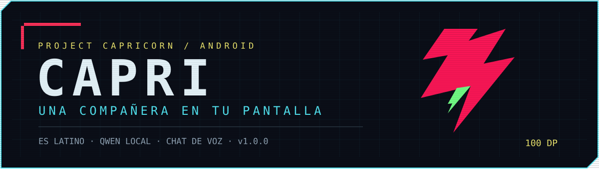
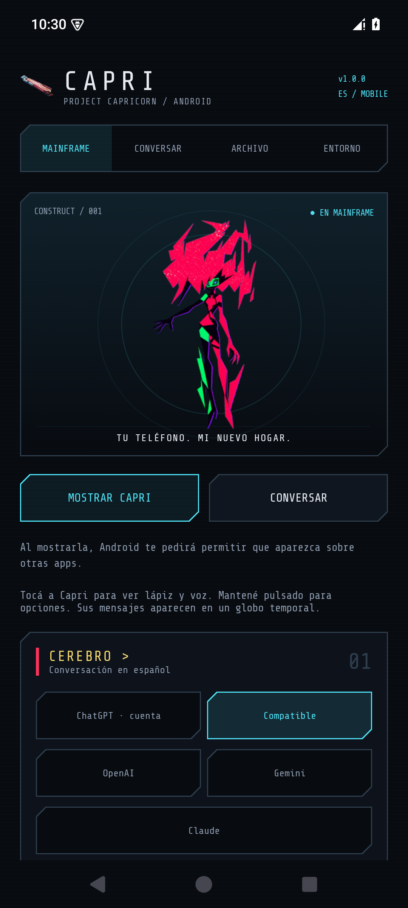
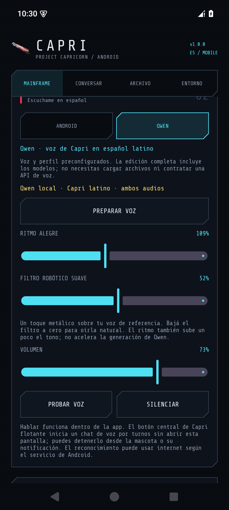
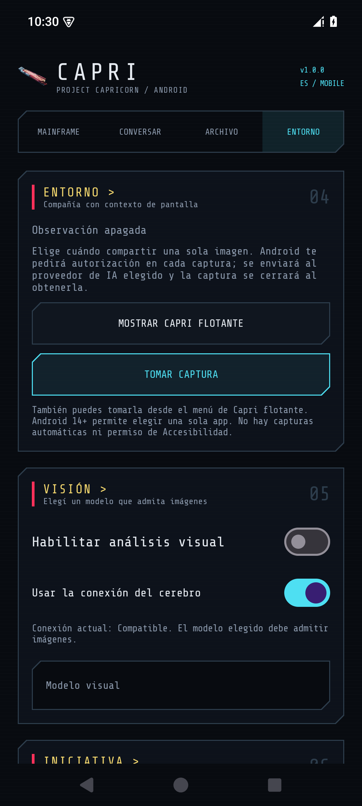
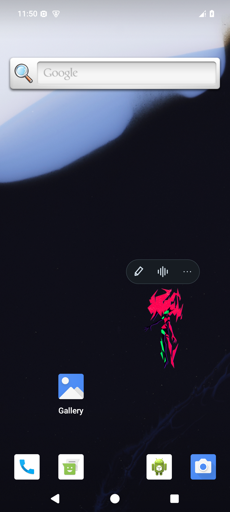
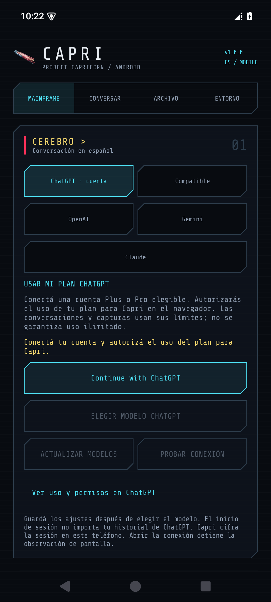

<div align="center">



<a href="https://github.com/4lexxe/capri_cyberpunk_MOBILE/releases/latest/download/Capri-Android-1.0.0-completa.apk"></a>

[](https://github.com/4lexxe/capri_cyberpunk_MOBILE/releases/latest)
[](https://github.com/4lexxe/capri_cyberpunk_MOBILE/releases/tag/v1.0.0)
[](https://github.com/4lexxe/capri_cyberpunk_MOBILE/stargazers)

**Tu compañera cyberpunk: animada, juguetona y con voz en español latino.**

[Descargas y versiones](https://github.com/4lexxe/capri_cyberpunk_MOBILE/releases) · [Configuración](#configuración-inicial) · [Privacidad](docs/PRIVACIDAD.md) · [Compilar](docs/COMPILAR.md)

</div>

> [!TIP]
> **¿Quieres que siga desarrollando Capri y trayendo actualizaciones? Deja tu ⭐ en este repositorio.** Es el apoyo que pedimos a quienes usan la app. Puedes descargarla y probarla sin crear una cuenta en Capri.

## Qué hace Capri

| 🩵 En tu pantalla | 💛 Dentro de la app |
| --- | --- |
| Mascota flotante de **100 dp por defecto**, arrastrable y con animaciones. | Conversación con ChatGPT, OpenAI, Gemini, Claude o un servidor compatible. |
| Globos temporales con **×** para cerrarlos. | Personalidad breve, alegre y en español latino. |
| Botón central para **chat de voz desde la mascota**, sin abrir el chat. | **Qwen3-TTS local** con modelos y perfil de voz incluidos en el APK completo. |
| Capturas **manuales**, una imagen por autorización de Android. | Voz Android como alternativa y controles de ritmo, volumen y efecto robótico. |

Es un **proyecto de fans no oficial**, basado en [Capri Desktop de Lachy](https://github.com/lachydotmcg/capri-desktop). No hay afiliación con los titulares del personaje ni con los proveedores de IA. Se conservan sus créditos y licencias.

## Un vistazo

<p align="center">
  
  
  
</p>

<p align="center">
  
</p>

Capturas de la app en un emulador Android. La velocidad y la apariencia del sistema pueden variar según el teléfono.

## Descargar e instalar

**Descarga principal:** [Capri Android 1.0.0 completa con Qwen](https://github.com/4lexxe/capri_cyberpunk_MOBILE/releases/latest/download/Capri-Android-1.0.0-completa.apk).

| Archivo de la release | Para qué sirve |
| --- | --- |
| **completa.apk**, aproximadamente 910 MB | Primera instalación o instalación con todos los modelos Qwen incluidos. |
| **actualizacion.apk**, aproximadamente 26 MB | Actualizar una instalación que ya conserve los modelos; también permite la voz Android. |
| **source.zip** | Código fuente y documentación, sin claves privadas ni los pesos grandes. |
| **SHA256SUMS.txt** | Comprobar la integridad de los archivos descargados. |

1. Descarga el APK desde **Releases de este repositorio**. Reserva cerca de **2 GB libres** para el APK y los modelos preparados.
2. Abre el archivo. Si Android lo pide, permite instalar desde la aplicación que estés usando para abrirlo, por ejemplo el navegador o Archivos. El nombre y la ubicación del ajuste dependen del fabricante.
3. Confirma la instalación. Si ya usabas una versión de prueba, **instala encima sin desinstalar** para conservar datos y modelos. Se mantiene el historial de firmas y el código interno sube a 10 aunque el nombre público sea 1.0.0.
4. Abre Capri y deja terminar la preparación de Qwen. El APK completo ya lleva los pesos y el perfil de voz; la preparación inicial copia y verifica esos archivos localmente.
5. Puedes retirar después la autorización de instalar desde esa fuente en los ajustes de Android.

> [!IMPORTANT]
> **APK fuera de Google Play:** Android puede mostrar un aviso de origen desconocido y Play Protect puede pedir analizarlo. Que Capri sea un proyecto no oficial no garantiza su seguridad ni explica cualquier alerta. Mantén Play Protect activo y permite el análisis. Si el sistema **bloquea la app o la identifica como peligrosa**, cancela y [reporta el aviso](https://github.com/4lexxe/capri_cyberpunk_MOBILE/issues) con la versión y el texto del error; no compartas claves ni pantallas privadas. Esta release usa capturas manuales y **no declara Accesibilidad**, permiso relacionado con un bloqueo de una edición de prueba anterior.

### Requisitos

- Android **8 o posterior**, procesador de 64 bits ARM64. Se incluye x86_64 para desarrollo y emuladores.
- **Qwen necesita Android 12 o posterior**. En Android anteriores utiliza la voz del sistema.
- Internet y una conexión propia a un proveedor para conversar y analizar imágenes. Qwen genera la voz dentro del teléfono, sin clave de voz externa.
- Tener 8 GB de RAM no garantiza voz en tiempo real: también importan el procesador, la temperatura y las apps abiertas. Puedes elegir Android si priorizas una respuesta de voz más rápida.

## Configuración inicial

### 01 / Conectar el cerebro

<p align="center"></p>

Abre **Mainframe → Cerebro**. Elige una de estas rutas y guarda los ajustes:

**ChatGPT · cuenta**

1. Elige **ChatGPT · cuenta** y toca **Continue with ChatGPT**.
2. Completa la autorización en el navegador; revisa que el acceso sea en `auth.openai.com`.
3. Vuelve a Capri, actualiza la lista y elige un modelo disponible para tu cuenta.
4. Pulsa **Probar conexión** y espera una respuesta completa. Después guarda los ajustes.

Esta ruta depende de la disponibilidad, los permisos y los límites de tu cuenta. La lista la entrega el proveedor; no todos los modelos admiten imágenes. No se promete acceso ilimitado ni disponibilidad para todas las cuentas. [Guía de Capri](docs/CONECTAR_CHATGPT.md) · [Documentación oficial de modelos e inferencia](https://developers.openai.com/siwc/token-sharing-open-source/models-and-inference).

**Clave API propia**

1. Elige **OpenAI**, **Gemini**, **Claude** o **Compatible**.
2. Pega tu clave, escribe un ID de modelo habilitado para tu cuenta y conserva la URL del proveedor salvo que uses tu propio servidor.
3. Guarda y prueba una conversación. Para capturas, usa un modelo que acepte imágenes.

| Proveedor | Dónde empezar | URL base en Capri |
| --- | --- | --- |
| OpenAI | [Crear una clave](https://platform.openai.com/api-keys) · [Guía oficial](https://developers.openai.com/api/docs/quickstart) | `https://api.openai.com/v1` |
| Gemini | [Google AI Studio](https://aistudio.google.com/) | `https://generativelanguage.googleapis.com/v1beta/openai` |
| Claude | [Anthropic Console](https://console.anthropic.com/) | `https://api.anthropic.com/v1` |
| Compatible | Tu proveedor o servidor con API compatible | La URL que te entregue ese servicio |

Las claves API y el acceso por cuenta son configuraciones distintas. Cada proveedor aplica sus condiciones y límites. Capri no incluye claves compartidas: **no pegues tus claves en issues, capturas o commits**.

### 02 / Preparar la voz

En **Mainframe → Voz**, elige:

- **Qwen:** la edición completa ya trae los modelos y el perfil de Capri en español latino. Espera la preparación y toca **Probar voz**. No necesitas subir un audio ni contratar una API de voz.
- **Android:** usa el motor de texto a voz instalado en el teléfono. Si falta español, instálalo desde los ajustes de ese motor; su timbre depende del dispositivo.

El preset inicial usa **ritmo 109%**, **filtro robótico 52% del control** y **volumen 73%**. Puedes ajustarlo. Una voz de referencia Qwen no se convierte automáticamente en una voz del motor Android.

### 03 / Mostrar la mascota

1. Pulsa **Mostrar Capri flotante**.
2. Concede **Mostrar sobre otras apps**. Permite notificaciones para tener a mano los controles de detención.
3. Arrástrala para moverla; un toque muestra los iconos y mantener pulsado abre las opciones.

| Control | Acción |
| --- | --- |
| Lápiz | Abrir conversación escrita. |
| **Botón central de voz** | Iniciar una sesión de voz sin entrar al chat; tocar de nuevo la detiene. |
| Tres puntos / mantener pulsado | Sentarla, tomar una captura, detener voz u ocultarla. |
| × del globo | Quitar el mensaje que está mostrando. |

El tamaño inicial es **100 dp**; puedes cambiarlo en Mainframe. Al actualizar se conserva el tamaño que ya hubieras guardado.

### 04 / Hablar desde otra app

Toca el botón central de la mascota y concede micrófono si Android lo pide. Empieza a hablar, Capri envía el texto reconocido a tu proveedor y responde con la voz que elegiste. Después vuelve a escuchar otra frase.

La sesión tiene una notificación **Detener voz**, y el icono de la mascota cambia a **Cerrar chat de voz**. La escucha se pausa mientras se genera o reproduce la respuesta. No hay palabra de activación ni escucha permanente: se cierra al detenerla, bloquear el teléfono, ocultar a Capri, abrir la app principal o agotarse la espera sin otra frase. Cada sesión dura como máximo cinco minutos; puedes iniciar otra con un toque.

El reconocimiento lo presta el servicio de Android y puede requerir internet o enviar audio a su proveedor. Qwen genera la respuesta hablada localmente. La conversación y la voz son por turnos; no se promete audio instantáneo en todos los teléfonos.

### 05 / Compartir una captura

1. En **Entorno**, habilita el análisis visual, selecciona una conexión/modelo con imágenes y **guarda**.
2. Pulsa **Tomar captura** en Entorno o desde el menú de Capri flotante.
3. Lee el aviso y elige la pantalla en el diálogo de Android. Android 14+ permite seleccionar una app o toda la pantalla.
4. Se obtiene **una imagen** y se cierra la captura antes del envío. No se guardan videos ni se repite automáticamente.
5. **Olvidar captura** descarta el contexto y cancela el análisis pendiente. No retira una imagen que el proveedor ya recibió.

Cada solicitud pide una autorización nueva. La imagen puede incluir información personal visible; elige con cuidado qué compartes. Los resúmenes persistentes son opcionales y puedes borrarlos en Entorno. [Detalles de capturas](docs/CAPTURAS_MANUALES.md) · [Privacidad](docs/PRIVACIDAD.md).

## Si algo falla

| Problema | Qué revisar |
| --- | --- |
| La app no se instala | Usa el APK completo para una primera instalación. Lee el aviso exacto de Android; conserva Play Protect y los datos de la instalación anterior. |
| No responde la IA | Modelo, conexión, autorización o crédito/límite del proveedor. Prueba la conexión antes de activar la voz. |
| Qwen tarda | Espera a que termine la preparación. Reduce otras tareas o prueba voz Android; bajar el volumen o el tamaño del WAV no elimina el trabajo del modelo. |
| El micrófono se cierra | Permiso de micrófono y servicio de reconocimiento instalado/habilitado. Al terminar una frase o una espera sin voz puede cerrarse la sesión. |
| No aparece Capri | Permiso Mostrar sobre otras apps y restricciones de batería del fabricante. |
| La captura sale vacía o falla | Algunas apps protegen su contenido; Capri respeta esa protección. Autoriza una captura nueva. |

[Reportar un problema](https://github.com/4lexxe/capri_cyberpunk_MOBILE/issues/new). Indica modelo del teléfono, versión de Android y mensaje exacto. **Nunca publiques claves, tokens, conversaciones o capturas sensibles.**

## Código y compilación

Los fuentes Kotlin, C++, sprites, perfil de voz y licencias están incluidos. Los pesos Qwen se distribuyen en el **APK completo de Releases**, no como archivos grandes dentro de Git; la descarga reproducible está fijada por revisión, tamaño y SHA-256 en `models.lock.json`.

Necesitas JDK 17+, Python 3.11+, SDK 36, NDK 27.2.12479018 y CMake 3.22.1:

```powershell
python scripts/fetch-qwen.py
./gradlew.bat :app:testReleaseUnitTest :app:lintRelease :app:assembleRelease -PbundleQwen=true
```

La configuración por defecto usa capturas manuales. La firma de producción requiere tus almacenes privados y el historial original si actualizas esta app; no se publican claves privadas. [Compilar y firmar](docs/COMPILAR.md) · [Validación de la release](docs/VALIDACION_PUBLICA_1.0.0.md).

| Carpeta | Contenido |
| --- | --- |
| `app/src/main` | Interfaz, mascota, conversación, voz y servicios Android. |
| `app/src/manual` | Manifest de capturas manuales, sin Accesibilidad. |
| `app/src/test` / `app/src/androidTest` | Pruebas de lógica y dispositivo. |
| `third_party` | Fuentes nativas y procedencia de dependencias. |
| `scripts` | Modelos, firma y empaquetado. |
| `docs` | Guías, imágenes e informes; las ediciones previas están documentadas como históricas. |

## Créditos y licencia

**Capri Desktop / Lachy:** personaje, sprites, animaciones y lenguaje visual original. Adaptación Android mantenida por **4lexxe**. Los recursos originales conservan su autoría y sus avisos de copyright.

Distribución no comercial bajo [PolyForm Noncommercial 1.0.0](LICENSE.md). [Atribuciones completas](NOTICE.md): Qwen y sus modelos Apache 2.0, motor/GGML MIT y Share Tech Mono SIL OFL. Consulta las licencias de cada componente y **Archivo → Licencias** en la app.

<div align="center">

**💛 Si quieres más animaciones, mejoras de voz y nuevas versiones: deja tu ⭐.**

[**APOYAR EL PROYECTO EN GITHUB**](https://github.com/4lexxe/capri_cyberpunk_MOBILE)

</div>

