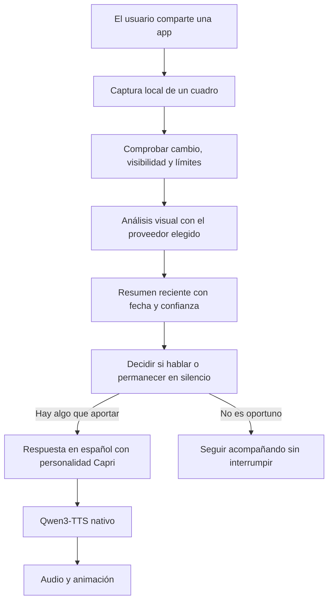

# Plan: Capri contextual, dinámica y con voz local

Fecha: 29 de octubre de 2026.

Actualización: el alcance principal ya está implementado en 0.2.0. Ver [guía de uso](USAR_CAPRI_CONTEXTUAL.md) y [validación](VALIDACION_0.2.0.md). Este documento conserva el diseño que guio la implementación; el APK 0.1.0 mencionado debajo es la base histórica.

## Objetivo

Convertir Capri en una compañera que reacciona al entorno del teléfono: observa contenido que el usuario comparte explícitamente, mantiene un resumen reciente, decide cuándo tiene sentido intervenir y responde en español con animación y voz Qwen3-TTS ejecutada en Android.

Ejemplo: el usuario comparte TikTok con Capri. Tras observar algunos cuadros y reconocer un contexto suficiente, Capri puede comentar “¿Qué apareció ahora? Ese gato ya me cayó mejor que medio Night City”. Si sólo reconoce la interfaz y no entiende el contenido, puede preguntar “¿Qué estás mirando, choom?” sin inventar de qué trata el video.

Este documento define el producto y la implementación propuesta. El APK 0.1.0 sigue siendo la base existente: no incorpora todavía captura de pantalla, modelos visuales, intervenciones espontáneas ni Qwen nativo.

## Experiencia del usuario

1. En el primer uso, explicar de forma visible qué observa Capri, qué información se envía al proveedor de IA y qué se conserva. La observación permanece apagada hasta activarla.
2. Separar las opciones **Conversar**, **Compartir pantalla con Capri** y **Recordar actividades**. Conversar no requiere compartir pantalla.
3. Al elegir **Compartir pantalla**, Android presenta su autorización. En Android 14 o posterior, comenzar con una sola aplicación elegida por el usuario.
4. Mientras la sesión está activa, mostrar un estado claro en Capri y una notificación con **Pausar comentarios** y **Detener observación**. Pausar comentarios no debe confundirse con detener captura y envíos.
5. El personaje puede escuchar, pensar, mirar con curiosidad, sonreír, hablar, aburrirse o dormir. Los estados expresan lo que el sistema está haciendo; no sirven como prueba de lo que el usuario siente.
6. Tocar **Hablar** abre el micrófono dentro del flujo ya existente. No se incorpora escucha permanente de fondo como requisito de esta fase.
7. Al detener observación, cancelar capturas, solicitudes pendientes y comentarios de esa sesión; descartar resultados tardíos. La conversación escrita continúa disponible.

El consentimiento inicial del producto y la autorización del sistema son distintos. Android requiere autorización por sesión de MediaProjection y no permite reutilizar un token para nuevas sesiones. Desde Android 15 QPR1, bloquear la pantalla también detiene la proyección. La app debe gestionar su finalización y solicitar una sesión nueva cuando corresponda. [Documentación de MediaProjection](https://developer.android.com/media/grow/media-projection).

## Flujo técnico



Separar los proveedores de **conversación**, **visión** y **voz**. Se puede usar el mismo modelo remoto para conversación y visión si admite imágenes, o modelos distintos. Una clave y un modelo de texto no implican automáticamente capacidad visual. Qwen3-TTS sólo convierte la respuesta a audio: no interpreta capturas.

Para esta etapa, la conversación y la visión pueden usar servicios externos. La voz Qwen será local. La descarga inicial de modelos sí necesita conexión; la generación posterior de voz no depende de un servidor. Una visión totalmente local queda como extensión, después de conocer el teléfono y medir recursos.

## Captura: alcance inicial

- Implementar un servicio independiente `ScreenContextService` de tipo `mediaProjection`, con la declaración y los permisos requeridos.
- Usar `MediaProjection`, `VirtualDisplay` e `ImageReader`. No grabar ni conservar un video completo.
- Comenzar en Android 14+ compartiendo una app. Excluye barras y notificaciones del sistema, aunque no elimina el contenido sensible que pueda existir dentro de la app elegida.
- Usar `onCapturedContentVisibilityChanged` para pausar el análisis y las intervenciones cuando el contenido compartido no esté visible. Una captura antigua no demuestra que el usuario siga en esa actividad.
- Gestionar rotación y cambios de tamaño sin crear otra sesión con el mismo token. Cerrar siempre las imágenes adquiridas y liberar superficies y buffers al terminar.
- No usar AccessibilityService para obtener pantallas. No solicitar acceso al historial de uso en el primer alcance.
- Respetar contenido protegido: si Android entrega una superficie vacía o impide la captura, informar que Capri no puede observarla y no intentar eludirlo.

Referencias: [visibilidad de contenido capturado](https://developer.android.com/reference/android/media/projection/MediaProjection.Callback#onCapturedContentVisibilityChanged(boolean)), [servicio mediaProjection](https://developer.android.com/develop/background-work/services/fgs/service-types#media-projection) y [FLAG_SECURE](https://developer.android.com/security/fraud-prevention/activities).

Compartir todo el teléfono y reaccionar al cambiar entre múltiples aplicaciones es una fase posterior. Requiere diseñar selección de apps, detección de transiciones y exclusiones antes de habilitar capturas generales. No se presupone que conocer una aplicación por una imagen otorgue acceso a sus datos internos.

## Resumen de contexto

Mantener un contexto pequeño en memoria, separado del historial de conversación:

```json
{
  "sessionId": "identificador-local",
  "observedAt": "fecha-con-zona-horaria",
  "source": "aplicacion-compartida-por-el-usuario",
  "observation": "Se ve una interfaz de videos cortos y un gato en pantalla",
  "activity": "viendo videos cortos",
  "confidence": "medium",
  "expiresAfterSeconds": 120,
  "suggestedReaction": "curiosity",
  "shouldSpeak": false
}
```

La estructura es un contrato propuesto. La salida del modelo debe validarse, limitarse en longitud y tratarse como datos. Los textos visibles en capturas, páginas o mensajes no pueden cambiar las instrucciones del sistema, pedir claves ni conceder capacidades.

Cada conclusión debe diferenciar lo que se vio de una inferencia. Un cuadro estático no permite escuchar el video, conocer toda su historia o afirmar cuánto tiempo lleva viéndolo el usuario. Los tiempos se obtienen del estado de sesión, no de una suposición del modelo.

El contexto reciente caduca inicialmente a los dos minutos, se invalida al detener la sesión y se descarta cuando hay resultados fuera de orden. No arrastrar comentarios sobre TikTok a otra actividad.

## Motor de iniciativa

El modelo puede sugerir una intervención, pero una política local decide si se presenta. Esto permite controlar repeticiones y consumo independientemente del proveedor.

Parámetros iniciales para probar, no cifras de rendimiento garantizadas:

| Decisión | Valor inicial propuesto |
| --- | --- |
| Comprobar un cuadro candidato | Cada 15 segundos mientras el contenido esté visible |
| Enviar una imagen a visión | Como máximo una por minuto, sólo si cambia significativamente |
| Observaciones simultáneas | Una; descartar cuadros intermedios, sin acumular una cola |
| Tiempo mínimo entre comentarios espontáneos | 3 minutos |
| Tope por hora | 6 comentarios espontáneos |
| Tras dos comentarios sin respuesta | Reducir iniciativa y esperar interacción |
| Chat, micrófono o voz ocupados | Esperar; la interacción del usuario tiene prioridad |
| Contexto vencido, sesión detenida o baja confianza | Permanecer en silencio |

La captura local y el envío al proveedor son operaciones distintas. Detectar cambios con una imagen reducida evita llamadas idénticas. Se deben medir batería, datos y costo de visión; no analizar cada cuadro de video.

Ofrecer frecuencias **Tranquila**, **Normal** y **Habladora**, con límites máximos. No convertir cada reconocimiento de actividad en una pregunta. Alternar preguntas, bromas breves, observaciones y silencio. Evitar regaños o conclusiones sobre emociones, salud u otros rasgos personales a partir de la pantalla.

Antes de hablar, verificar que la observación siga vigente y que la sesión siga autorizada. Si el usuario empieza a escribir o hablar, cancelar la intervención espontánea y su síntesis pendiente.

## Memoria y resumen de actividades

Separar dos funciones:

- **Contexto inmediato:** sirve para reaccionar ahora; vive en memoria y expira.
- **Recuerdo de actividades:** opción explícita para guardar resúmenes breves y revisables en el teléfono.

Por defecto, no guardar capturas en archivos, galería, historial ni registros. Los buffers temporales se liberan después del análisis. No afirmar que un proveedor externo elimina inmediatamente los datos: deben consultarse sus condiciones y explicarse en la configuración.

El resumen de actividades sólo cubre sesiones efectivamente observadas: por ejemplo, “Durante la sesión compartida viste algunos videos cortos y abriste un tutorial”. No presentarlo como el historial completo del día.

La memoria persistente debe tener fecha, origen, vencimiento y opción de borrar. Propuesta inicial: retención de 7 días para resúmenes habilitados por el usuario, con acceso desde **Lo que Capri recuerda**. No extraer ni memorizar contraseñas, códigos de acceso, información financiera o detalles privados innecesarios para la compañía contextual. El filtrado automático es una ayuda y no una garantía de detección completa.

La pantalla de activación debe indicar si se envían imágenes o solamente texto procesado localmente y nombrar el proveedor seleccionado. Un modo futuro de OCR local puede enviar sólo texto, pero por sí solo pierde buena parte de la comprensión visual de los videos. [Divulgación y consentimiento para Google Play](https://support.google.com/googleplay/android-developer/answer/11150561).

## Voz Qwen nativa y animación

Mantener el requisito aceptado: ejecutar la voz en el teléfono. Usar como referencia [qwen3-tts-android](https://github.com/Danmoreng/qwen3-tts-android), que integra `qwen3-tts.cpp` con JNI y modelos 0.6B Base Q4_K_M.

El paquete comprobado suma aproximadamente 884 MB de pesos y tokenizer. El proyecto de referencia requiere ARM64 y Android 12+. Debe validarse si la integración conserva ese mínimo como requisito de la función o requiere otra variante del APK, sin cambiar silenciosamente la compatibilidad de la base actual.

Descarga con progreso, verificación de integridad, detección de almacenamiento insuficiente, eliminación de modelos y estado de motor listo. Guardar un perfil de voz reutilizable. Evaluar una muestra de referencia y generación en español antes de prometer parecido.

Usar una sola instancia de inferencia y generación fuera del hilo de interfaz. Medir carga inicial, memoria máxima, tiempo hasta el primer audio, duración de síntesis y cancelación. La animación de boca debería pasar a seguir la amplitud del PCM; el movimiento de la versión 0.1.0 es aproximado.

Dar prioridad a la voz solicitada por el usuario. Los comentarios espontáneos no deben superponerse al audio de Capri en curso. Gestionar el foco de audio y ofrecer silenciar o bajar el volumen de comentarios. La política ante el audio de TikTok debe ser configurable; no asumir que capturar pantalla también permite escuchar su audio.

## Cambios respecto de la base actual

| Archivo o módulo | Cambio propuesto |
| --- | --- |
| `MainActivity.kt` | Flujo de activación, resultado de MediaProjection y estado de sesión |
| `AndroidManifest.xml` | Servicio y permiso mediaProjection; mantener separados overlay y observación |
| `CapriSettings`, `CapriStore` | Preferencias de iniciativa, proveedor visual, memoria y motor Qwen |
| `BrainClient.kt` | Proveedores explícitos y mensajes multimodales; reemplazar la regla actual que dice que Capri no puede ver pantalla por capacidades reales y contexto fechado |
| `ScreenContextService` | Captura y ciclo de vida, sin almacenamiento de imágenes por defecto |
| `ContextAnalyzer` | Análisis visual, contrato estructurado y validación |
| `ContextRepository` | Contexto temporal y resúmenes persistentes opcionales |
| `InitiativePolicy` | Frecuencias, prioridad, silencios y deduplicación |
| `VoiceController` + `QwenEngine` | Motor nativo, cola, cancelación y PCM |
| `CompanionService`, `CapriScreen` | Estados visibles, botones de pausa/detención y memoria revisable |

## Orden de trabajo

1. **Proveedores y contexto explícito:** conversación y visión configurables, prueba de una captura seleccionada manualmente, respuesta contextual visible y sin observación automática.
2. **Qwen nativo:** carga y descarga del modelo, perfil de voz, síntesis española, reproducción y cancelación en el teléfono objetivo.
3. **Sesión de observación:** MediaProjection, captura de una app, notificación, visibilidad y finalización. El botón **Mirá esto** produce primero una reacción a pedido.
4. **Iniciativa y personalidad:** activar comentarios espontáneos con reglas locales y estados de animación. Ensayar escenarios de TikTok con contenido de prueba.
5. **Resumen y memoria:** habilitar resúmenes de sesión, revisar recuerdos y borrar. Incorporar retención sólo al activar esa función.
6. **Validación sostenida:** rendimiento, batería, audio, cambios de app y red; revisar requisitos de distribución antes de publicar.

## Criterios de aceptación

- Sin una sesión autorizada no se capturan ni envían imágenes.
- Detener cancela trabajos y evita comentarios o respuestas tardías de la sesión cerrada.
- Pantalla bloqueada o contenido compartido no visible detiene o pausa el comportamiento correspondiente.
- Sin capacidad visual configurada, mostrar el motivo; no inventar una observación.
- La misma pantalla no provoca análisis y preguntas repetidos fuera de los límites.
- Con poca evidencia, Capri pregunta de forma abierta o guarda silencio.
- Al escribir o hablar, el usuario interrumpe una iniciativa pendiente.
- Las capturas protegidas o vacías no se convierten en descripciones inventadas.
- El usuario puede ver y borrar lo recordado.
- Qwen funciona localmente una vez descargados los modelos; el informe de prueba distingue ese funcionamiento del acceso remoto del cerebro y la visión.
- Informar por separado tiempos de análisis, generación de respuesta y síntesis; medirlos en un teléfono real antes de prometer una experiencia inmediata.

Para optimizar Qwen sigue pendiente conocer el modelo exacto de teléfono y la RAM. El diseño de permisos, contexto y política de iniciativa puede avanzar sin ese dato.
